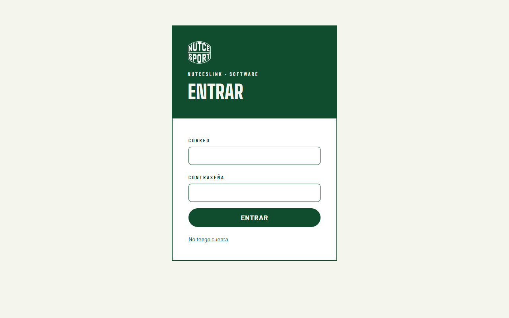
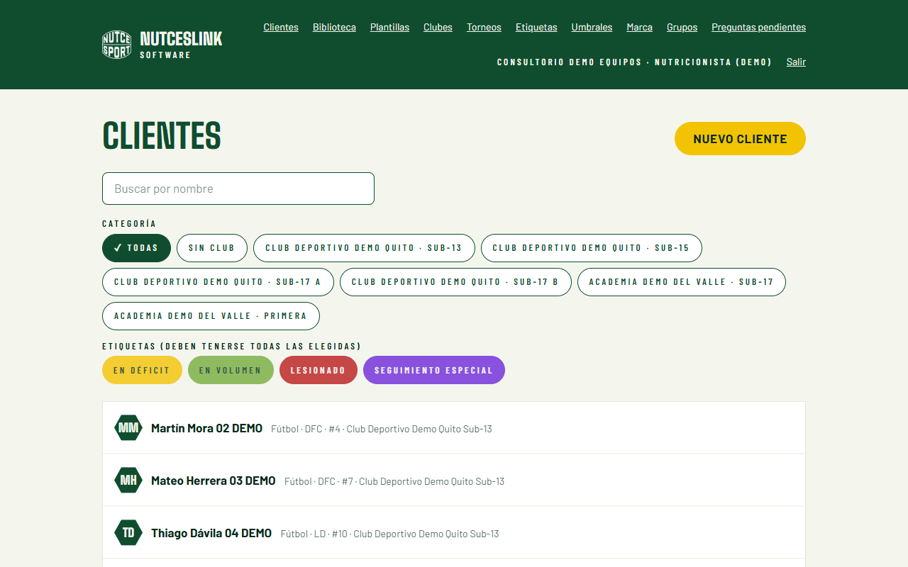
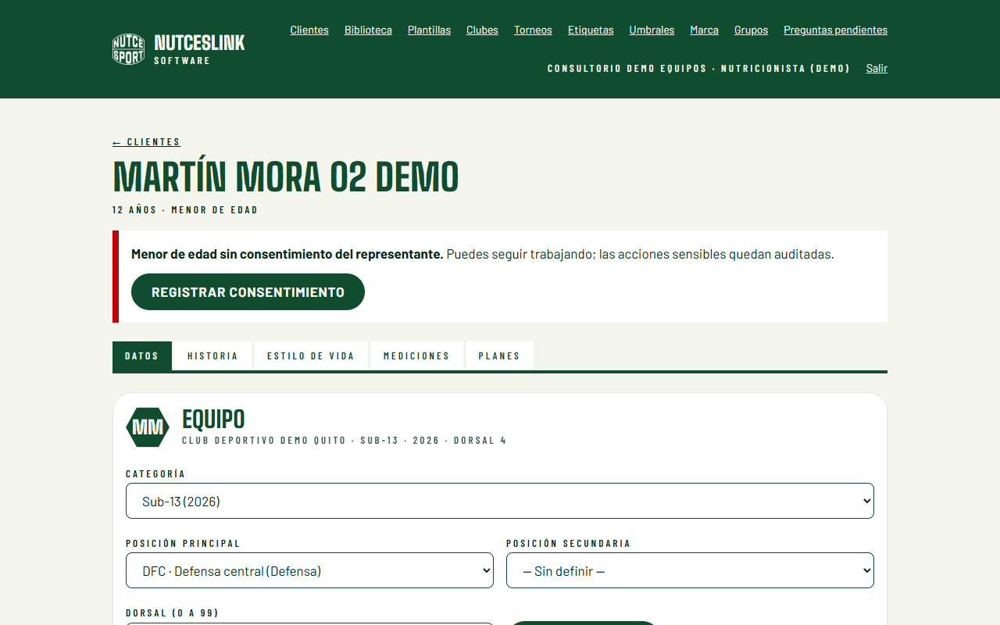
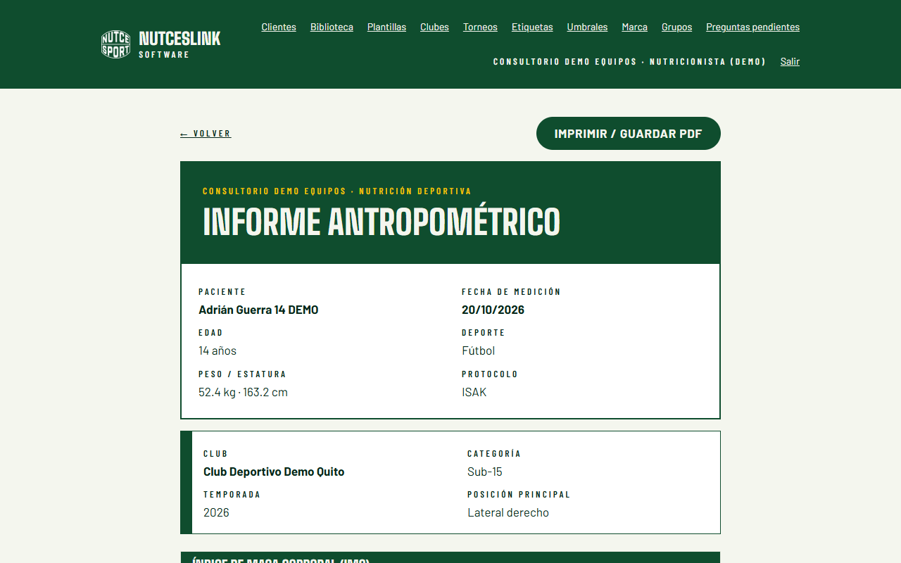
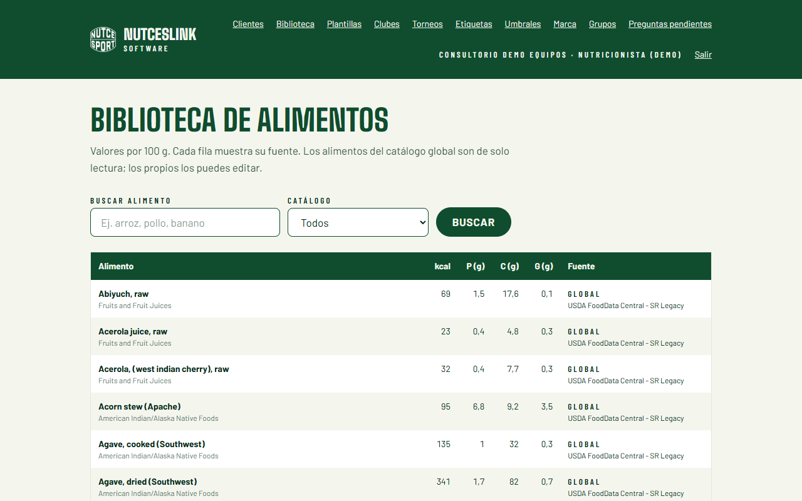

# Guía de páginas

Un recorrido por las pantallas, en el orden en que se usan. Todas las imágenes son capturas con datos ficticios.

## 1. Acceso
Entras con tu cuenta. Cada consultorio ve solo lo suyo.

## 2. Clientes (deportistas)
Lista con búsqueda y filtros por categoría y etiqueta. Si el deportista es menor y falta el consentimiento, aparece un aviso visible. **El aviso no bloquea el trabajo**, pero queda registrado.

## 3. Ficha del deportista
Datos mínimos, consentimiento, etiquetas y su historial de sesiones y planes. En un menor sin consentimiento del representante, la ficha muestra un aviso y un botón para registrarlo.

## 4. Nueva sesión de medición
Formulario con hasta tres repeticiones por pliegue. Mientras es borrador se puede editar. Al **finalizar**, los datos crudos quedan fijos.

## 5. Resultados con fuente
IMC, suma de pliegues (Σ6, Σ8) y somatotipo. Junto a cada cifra aparece la fuente y la versión de la fórmula.

## 6. Progreso
Compara sesiones entre fechas.

## 7. Informe del jugador
Página lista para imprimir o guardar en PDF.

## 8. Clubes y categorías
Organizas a los deportistas por club, categoría y posición, con etiquetas (máximo tres visibles por jugador).

## 9. Tablero e informe de equipo
Resumen de una categoría y su informe imprimible.

## 10. Plan nutricional
El sistema propone un borrador con reglas, sin inteligencia artificial. Tú lo editas. **Solo un plan aprobado se puede enviar**, y si lo editas después vuelve a borrador.

## 11. Biblioteca de alimentos y plantillas
Alimentos para armar el plan, con la fuente de cada valor, y plantillas para reutilizarlo.

---

**En borrador, no incluido como resultado verificado:** composición corporal (Kerr, 5 componentes) y maduración.
